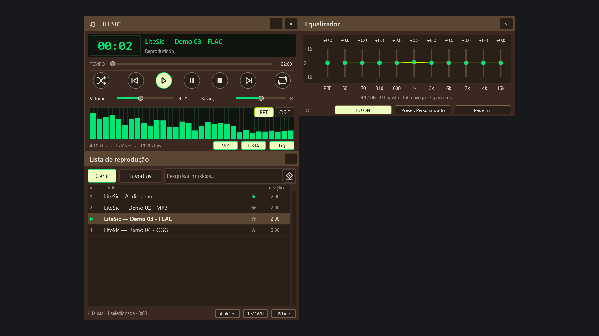
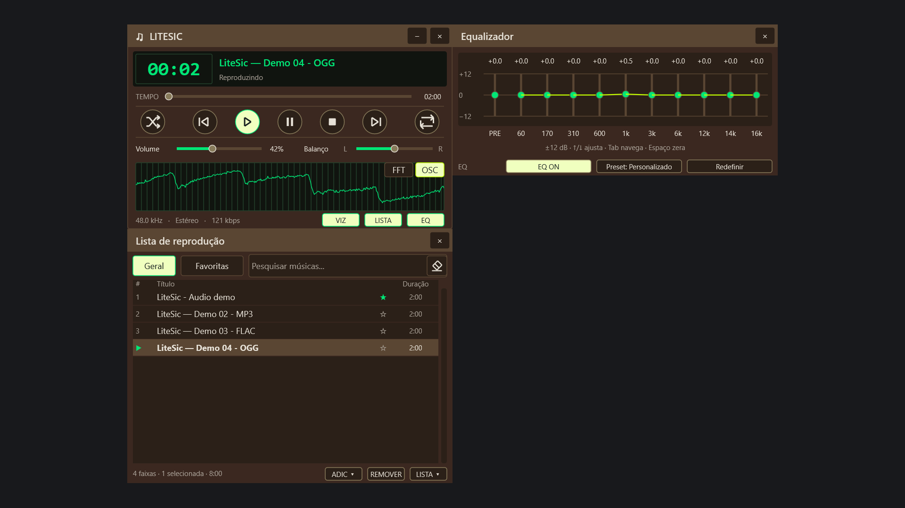
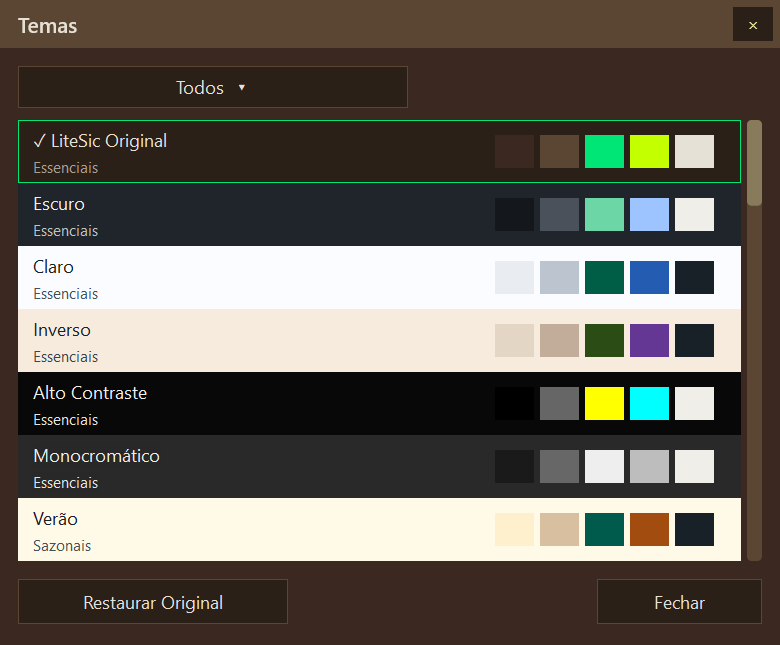
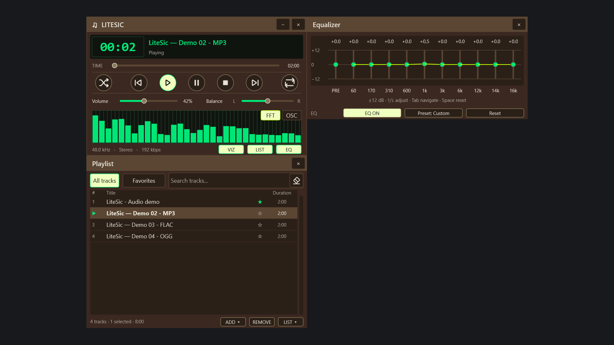

# LiteSic

**Suas músicas, do seu jeito.** Um player de áudio para Windows inspirado na experiência clássica do Winamp, com playlist, equalizador e visualizador em painéis que você organiza na tela.

[Baixar para Windows](https://github.com/Karkoff/litesic/releases) · [Como usar](#como-usar) · [Telas](#telas) · [Relatar um problema](https://github.com/Karkoff/litesic/issues)



Gratuito e de código aberto, sem anúncios, assinatura ou conta. Reproduz seus arquivos locais e guarda suas preferências no computador.

## O que você pode fazer

| Recurso | No dia a dia |
| --- | --- |
| Música local | Ouça arquivos **MP3, WAV, FLAC e OGG Vorbis**. |
| Playlists | Adicione arquivos ou pastas, arraste do Explorer, reorganize faixas e importe ou exporte **M3U/M3U8**. |
| Pesquisa e favoritos | Encontre músicas na lista e marque as preferidas com uma estrela. |
| Equalizador | Ajuste **10 bandas**, pré-amplificação e presets enquanto a música toca. |
| Reprodução | Controle volume e balanço, ative o modo aleatório e repita a lista ou uma faixa. |
| Visualizador | Alterne entre **espectro de áudio (FFT)** e **osciloscópio (OSC)**. |
| Aparência | Escolha entre **36 temas**, ajuste a escala e encaixe os três painéis entre si. |
| Idiomas | Use a interface em **18 idiomas**, com seleção automática pelo Windows ou escolha manual. |
| Sua sessão | Retome a playlist, os favoritos, o volume, o tema e a disposição dos painéis ao reabrir. |

## Baixar e abrir

1. Escolha um dos pacotes da **versão final 1.0 (v1.0.0)** abaixo.
2. Extraia o ZIP inteiro para uma pasta de sua escolha.
3. Abra **LiteSic.exe**. Mantenha as subpastas que acompanham o aplicativo.

| Download | Indicado para |
| --- | --- |
| [Windows x64](https://github.com/Karkoff/litesic/releases/download/v1.0.0/LiteSic-v1.0.0-x64.zip) | Windows de 64 bits; preferências no perfil do Windows. |
| [Windows x86 (32 bits)](https://github.com/Karkoff/litesic/releases/download/v1.0.0/LiteSic-v1.0.0-x86.zip) | Windows de 32 bits; preferências no perfil do Windows. |
| [Portátil x64](https://github.com/Karkoff/litesic/releases/download/v1.0.0/LiteSic-v1.0.0-portable-x64.zip) | Windows de 64 bits; preferências junto ao aplicativo. |
| [Portátil x86 (32 bits)](https://github.com/Karkoff/litesic/releases/download/v1.0.0/LiteSic-v1.0.0-portable-x86.zip) | Windows de 32 bits; preferências junto ao aplicativo. |

Todos os pacotes incluem **18 idiomas**, ajuda e licenças. Os executáveis prontos não exigem ferramentas de desenvolvimento ou instalação de runtimes adicionais. [Notas da versão e checksums SHA-256](https://github.com/Karkoff/litesic/releases/tag/v1.0.0).

**Compatibilidade:** funcionamento verificado no Windows 11. A distribuição tradicional tem como alvo Windows 7 a 11, em x86 e x64; a validação prática nas versões anteriores do Windows ainda está pendente.

## Como usar

### Comece a ouvir

1. Clique em **LISTA** para mostrar a lista de reprodução.
2. No rodapé da playlist, abra **ADIC ▾** e escolha arquivos ou uma pasta. Você também pode arrastar músicas do Explorer para a lista.
3. Selecione uma faixa e clique em **Play**, ou dê dois cliques na música.
4. Use **Anterior**, **Pause**, **Stop** e **Próximo** para controlar a reprodução. Arraste a barra de tempo para avançar ou voltar na faixa.

Os controles de **Volume** e **Balanço** ficam no player. O botão de repetição alterna entre desligada, lista inteira (**REP**) e faixa atual (**REP 1**). Ative o botão de reprodução aleatória para variar a ordem das músicas.

### Organize suas músicas

- Digite no campo **Pesquisar músicas...** para filtrar a lista; use a borracha ao lado para limpar a pesquisa.
- Clique na **estrela** de uma faixa para marcá-la como favorita. A aba **Favoritas** reúne as músicas marcadas; iniciar a reprodução nessa aba toca somente as favoritas.
- Arraste as faixas para mudar a ordem. Use **Ctrl** ou **Shift** para selecionar várias músicas e **REMOVER** para retirá-las da playlist.
- Abra **LISTA ▾**, no rodapé da playlist, para acessar os comandos de listas, incluindo importação e exportação de M3U/M3U8.
- Clique com o botão direito em uma música para consultar suas informações.

A lista é salva automaticamente ao fechar o programa e recuperada na próxima abertura.

### Ajuste o som e o visualizador

Clique em **EQ** para mostrar o equalizador. Ative **EQ ON**, escolha um preset ou ajuste as dez bandas e o controle **PRE**. Os ajustes continuam valendo quando você oculta o painel; use o botão ON/OFF do próprio equalizador para ligar ou desligar o efeito.

No player, **FFT** mostra o espectro de áudio e **OSC** mostra a forma de onda. O botão **VIZ** oculta o visualizador e deixa o player mais compacto; clique novamente para restaurá-lo.



### Deixe a interface do seu jeito

Clique com o botão direito no player para escolher **Temas...**, ajustar a **escala da interface**, mudar o **Idioma** ou ativar **Sempre no topo**. O tema é aplicado aos três painéis sem interromper a música.

Na versão atual, mantenha a pasta [`locales/`](locales) ao lado do executável para ter os 18 idiomas. Sem os catálogos, o player usa o inglês incorporado.

Arraste os painéis pelas barras de título. Ao aproximar suas bordas, eles se encaixam e passam a acompanhar o movimento do conjunto. Para separar um painel, arraste sua própria barra de título. Os botões **LISTA** e **EQ** mostram ou ocultam os painéis correspondentes.



### Atalhos de teclado

Com um dos painéis do LiteSic em foco e fora de campos de texto:

| Tecla | Ação |
| --- | --- |
| **Z** / **B** | Faixa anterior / próxima |
| **X** | Reproduzir a faixa selecionada |
| **C** | Pausar (use **X** ou **Play** para retomar) |
| **V** | Parar |
| **L** | Mostrar ou ocultar a playlist |
| **Ctrl+D** | Ativar ou desativar a reprodução aleatória |

O player também responde às teclas multimídia do teclado. Para controlá-lo em segundo plano, ative os atalhos globais no menu do botão direito: **Ctrl+Alt+F9** reproduz/pausa, **Ctrl+Alt+F10** para, **Ctrl+Alt+F11** volta e **Ctrl+Alt+F12** avança.

### Leve suas preferências com você

Baixe uma das edições **Portátil**, extraia para uma pasta gravável e abra **LiteSic.exe** normalmente. As configurações e a sessão ficam em `data/`, junto ao executável. Mantenha o arquivo `resources/portable.flag`, que ativa esse comportamento automaticamente.

Na edição padrão, também é possível ativar o modo portátil ao iniciar com a opção `--portable`:

```powershell
.\LiteSic.exe --portable
```

Na edição padrão, sem essa opção, as preferências ficam em `%LOCALAPPDATA%\LiteSic`.

As playlists guardam caminhos absolutos das músicas. Se você mover os arquivos de áudio para outra pasta ou unidade, adicione-os novamente ou atualize a lista.

## Telas

As capturas desta página mostram o aplicativo real, com player, equalizador e playlist completos. Clique em uma imagem para abri-la em tamanho original.

**Interface em inglês** — os mesmos controles e painéis também estão disponíveis nos outros idiomas:



## Ajuda e privacidade

Encontrou um problema ou tem uma sugestão? [Abra uma issue no GitHub](https://github.com/Karkoff/litesic/issues) e informe sua versão do Windows, a versão do player e os passos para reproduzir o comportamento.

O LiteSic funciona com arquivos locais e não envia suas músicas ou preferências ao publicador. Consulte a [política de privacidade](docs/PRIVACY.md). O aplicativo não inclui músicas nem oferece serviço de streaming.

<details>
<summary>Para contribuir: compilação, regras e testes</summary>

O LiteSic usa C++17, Win32 e Direct2D/DirectWrite. Consulte o [guia de desenvolvimento](docs/DEVELOPMENT.md) para preparar o ambiente MSYS2 com MinGW-w64 (**MINGW64/MINGW32**).

```bash
make ARCH=64 DEBUG=0  # Release x64
make ARCH=32 DEBUG=0  # Release x86
make test            # Testes da configuração selecionada
```

As [regras de implementação](AGENT.md) cobrem Unicode, compatibilidade Windows, threads nativas e segurança do callback de áudio. Para verificar a interface, consulte o [guia de validação gráfica](docs/GUI-AUTOMATION.md).

Para compilar, testar e gerar os quatro ZIPs com idiomas e licenças, execute `powershell -NoProfile -ExecutionPolicy Bypass -File scripts/package-desktop.ps1`. O procedimento e a verificação dos pacotes estão no [guia da release desktop](docs/DESKTOP-RELEASE-2026-11-03.md).

</details>

## Licença

Código aberto sob a [licença MIT](LICENSE).
