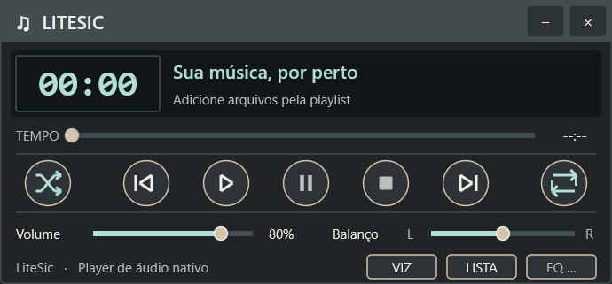
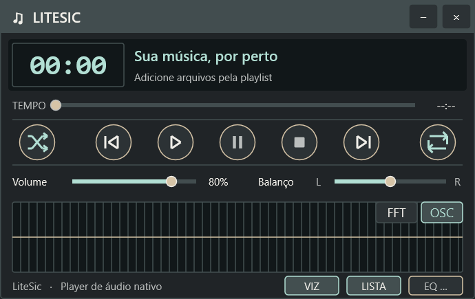

# Persistência da aparência — 11/10/2026

A aplicação restaura a visibilidade do visualizador, da playlist e do painel
EQ, o modo FFT/OSC, a escala da interface e o tema. O visualizador oculto já
abre com a altura compacta, sem mostrar primeiro a área vazia.

As preferências são gravadas ao alterá-las, em
`%LOCALAPPDATA%\LiteSic\settings.ini`, seção `Appearance`, junto do tema
existente. Mostrar/ocultar pela barra de status, fechar os painéis pelo X
ou pelos comandos de fechamento e abrir a playlist pelo menu atualizam
a preferência correspondente. Encerrar o player destrói as janelas sem
sobrescrever a visibilidade que o usuário escolheu.

| Chave | Padrão quando ausente ou inválida |
|---|---|
| `VisualizerVisible` | 1: visível |
| `PlaylistVisible` | 1: visível |
| `EqualizerVisible` | 0: oculto |
| `Spectrum` | 0: osciloscópio |
| `ScalePercent` | 0: automática; valores aceitos: 80, 90, 100, 110, 125, 150 |

Os arquivos existentes continuam funcionando, sem migração destrutiva.
A playlist é carregada e sua seleção recuperada mesmo quando sua janela
abre oculta. O painel EQ continua indisponível para processamento de áudio;
esta tarefa apenas preserva sua visibilidade. A persistência completa de
posição/geometria das janelas e demais configurações da M8 continua pendente.

## Verificação

- Builds x86/x64 Debug/Release: compilados e vinculados, sem novos avisos.
- Suíte x64 Debug: **93 testes aprovados**. Três casos novos verificam
  padrões, gravação/leitura preservando tema e valores inválidos. Um caso de
  janela recria player/playlist/EQ com INI isolado, confirma a altura compacta,
  escala restaurada, visibilidade dos painéis e seus comandos de fechamento.
- Windows 11, x64 Debug, escala 150%: fechar e reabrir com visualizador e
  playlist ocultos reproduziu o player de 690 × 321 pixels. A captura após
  reabrir tem o mesmo SHA-256 da captura anterior ao fechamento. Após
  reativá-los, uma nova reabertura confirmou o player de 690 × 435 pixels.
  A preferência original de visibilidade foi restaurada após o teste.
- A validação gráfica desta rodada cobre visualizador/playlist. EQ, escala
  e modo possuem cobertura automatizada; Windows 7 e persistência de geometria
  não foram validados nesta rodada.

| Antes de fechar | Reaberto oculto | Reaberto visível |
|---|---|---|
|  |  |  |

Capturas reais, registros com identidade/hash do executável e logs estão em
`evidence/appearance-persistence/`. Os testes usam INIs isolados em `build/`;
nenhuma configuração pessoal é incluída no pacote.
