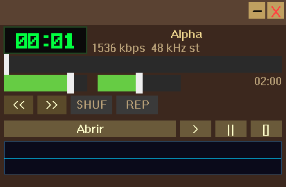
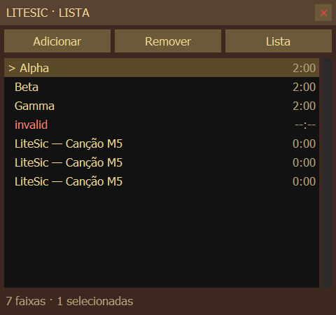

# M5 — implementação e validação em 11/10/2026

> Histórico da implementação inicial. Atualização posterior: **M5 COMPLETE**,
> com aceite visual, Explorer e M3U confirmados pelo usuário. Persistência,
> centralização, pesquisa, docking e memória foram revalidados no
> [encerramento técnico](M5-CLOSEOUT-2026-10-11.md). As pendências e descrições
> de implementação abaixo referem-se à versão anterior.

**Situação: IN_PROGRESS.** O escopo funcional está implementado e integrado.
Os quatro builds, os testes e as interações gráficas descritas abaixo passaram.
Faltam o gesto físico de drop pelo Explorer, a conferência manual externa do
M3U e a aprovação humana do checkpoint. Não declarar COMPLETE nem iniciar M6
antes dessas confirmações. Não houve commit ou push.

## A. Escopo

| Requisito | Implementação e evidência |
|---|---|
| T1 — modelo | Track com identidade estável, caminho, título, duração e flags; add/remove/move/clear, next/previous, repeat/shuffle; 11 casos |
| T2 — janela | Top-level Win32/GDI sem moldura, linhas e duração, seleção, scroll próprio/roda, tamanho mínimo e bordas redimensionáveis; capturas e arraste real |
| T3 — entrada | Diálogo multi-arquivo, seletor de pasta, varredura recursiva e handler WM_DROPFILES; testes da janela com HDROP; Explorer físico pendente |
| T4 — interação | Duplo clique/Enter toca, Delete remove, Ctrl/Shift selecionam, arraste reordena; testes do modelo e mouse/teclado reais |
| T5 — listas | Nome/duração em ambas as direções, embaralhamento visível, M3U UTF-8/EXTINF e caminhos relativos/absolutos; GUI e importação WMP COM; conferência manual externa pendente |
| T6 — metadados | Worker nativo, ID3v1/v2.2/v2.3/v2.4, comentários FLAC/OGG e duração; 8 casos de tags, 3 do worker e carga gráfica de pasta grande |

Equalizador, snap/dock, persistência de sessão, atalhos globais e distribuição
permanecem fora do trabalho. O menu para reabrir a playlist e a prevenção de
sobreposição ao mudar escala são necessários para utilizar a janela da M5.

## B. Arquitetura

- `playlist.h/.cpp`: modelo independente da janela e seleção por intervalo.
  A identidade da faixa atual sobrevive a sort, shuffle e reordenação.
- `playback.h/.cpp`: controlador integra a lista com `audio.cpp`. O timer da
  janela principal consulta EOF; o callback não navega nem chama a UI.
- `plwnd.h/.cpp`: desenho GDI, hit tests, diálogos, seleção, scroll, drag,
  comandos M3U e aplicação dos resultados do worker na thread da UI.
- `playlist_worker.h/.cpp`: um `CreateThread`, fila com `CRITICAL_SECTION`,
  eventos e semáforo. Publica via `PostMessage`; no máximo 64 resultados
  aguardam consumo. Varredura entrega lotes de 32 caminhos. Gerações e IDs
  impedem aplicar metadados a entradas removidas ou a uma lista limpa.
- `tags.h/.cpp`: leitura limitada a 4 MiB do início e 64 KiB do final,
  parsers com verificação de limites e decoder real para duração. OGG em
  push mode precisa da posição granule da página EOS para obter duração.
- `m3u.h/.cpp`: leitura local até 16 MiB, parser/escritor isolados, UTF-8,
  fallback de leitura CP1252 e gravação por temporário + flush + substituição.
- `app.cpp`, `mainwnd.cpp`, `audio.cpp`: criação/destruição, COM STA para
  diálogos, navegação real, atualização de título/seek e guards de áudio.

Não foram introduzidos framework de UI, threads STL ou dependências Python
no executável. `shell32` é a dependência nativa adicional para pasta/drop.

## C. Comportamentos implementados

A playlist abre junto ao player. Seu X oculta a lista; clique direito no
player → **Lista de reprodução** a reabre. Adicionar arquivos/pasta acrescenta
entradas. **Abrir** no player também acrescenta arquivos e toca o primeiro
selecionado. Duplicatas são permitidas, com identidades distintas.

Duplo clique ou Enter toca a seleção. Ctrl alterna linhas individuais, Shift
seleciona o intervalo e Ctrl+A seleciona tudo. Delete/Remover descarrega o
áudio se remover a faixa carregada. Arrastar linhas preserva sua ordem e a
identidade da faixa atual. A linha verde indica o destino durante o gesto.

Anterior reinicia a faixa acima de três segundos; abaixo disso navega para a
anterior. Próxima e EOF seguem a lista; sem repeat, o fim para a reprodução.
Repeat reinicia o ciclo da lista. Shuffle de reprodução visita cada identidade
uma vez por ciclo; ao repetir, evita a última identidade no primeiro sorteio
quando houver mais de uma. Anterior usa histórico no modo shuffle. Entradas
ausentes/corrompidas são puladas com limite de tentativas igual ao tamanho da
lista; uma lista inválida não fica num loop infinito.

**Lista** oferece ordenação por nome/duração, crescente/decrescente, shuffle
da ordem visível e limpar. Durações desconhecidas ficam antes das conhecidas
na ordem crescente e depois na decrescente. O shuffle visível é independente
do toggle SHUF do player.

Abrir M3U acrescenta entradas; não destrói a lista em caso de falha. Caminhos
relativos resolvem a partir da pasta do M3U. A gravação usa caminhos absolutos,
EXTINF e UTF-8 sem BOM. URLs de streaming não são suportadas. Tags e durações
chegam em background; arquivo inválido aparece em vermelho e falha explícita
de reprodução produz mensagem no rodapé.

## D. Compilação

GCC/G++ 16.2.0, Make 4.4.1, MSYS2 MINGW64/MINGW32, C++17,
`_WIN32_WINNT=0x0601`, MSVCRT e runtime GCC/C++ estático.

| Variante | Build | Casos | Áudio no dispositivo | GUI básica |
|---|---|---:|---:|---|
| x64 Debug | PASS | 68/68 | 4/4 | PASS + cobertura detalhada |
| x64 Release | PASS | 68/68 | 4/4 | PASS |
| x86 Debug | PASS | 68/68 | 4/4 | PASS |
| x86 Release | PASS | 68/68 | 4/4 | PASS |

Logs locais: `build/m5-final-build-{32,64}-{debug,release}.log`,
`build/m5-final-tests-*.log`, `build/m5-audio-*.log`.
Hashes/tamanhos: [resumo JSON arquivado](evidence/m5/validation-summary.json).
Importações: `build/m5-imports-*.txt`. DLLs diretas nas quatro variantes:
comdlg32, GDI32, KERNEL32, msvcrt, ole32, SHELL32 e USER32. Sem runtime Python,
Qt, .NET, libgcc/libstdc++ dinâmicos ou UCRT como dependência direta.

Permanecem warnings conhecidos: casts das APIs DPI opcionais e duas funções
GDI não utilizadas; no rebuild completo Release, três avisos de operações
atômicas internas do miniaudio já documentados na preparação do ambiente.
Nenhum warning novo da M5 permaneceu. Não foram silenciados globalmente.

As APIs de monitor usadas para posicionar a playlist têm mínimo Windows 2000,
conforme [MonitorFromWindow](https://learn.microsoft.com/en-us/windows/win32/api/winuser/nf-winuser-monitorfromwindow)
e [GetMonitorInfoW](https://learn.microsoft.com/en-us/windows/win32/api/winuser/nf-winuser-getmonitorinfow).
Isso não substitui a VM Windows 7 prevista para M9.

## E. Testes

**272 aprovações de casos, zero reprovações finais:** 108 execuções dos casos
anteriores + 164 execuções dos 41 casos novos. São 68 casos em cada variante.

| Suíte nova, vinculada ao código de produção | Casos por variante |
|---|---:|
| Modelo, seleção, filtros, ordenação, identidade e shuffle | 11 |
| M3U, EXTINF, Unicode, relativo/absoluto, round-trip e erros | 6 |
| Tags e arquivos sintéticos, erros e truncamento | 8 |
| Controlador com backend injetado para erros e limites | 5 |
| Áudio real offline, seek/duração, EOF e contenção da visualização | 5 |
| Worker real, recursão, geração/cancelamento e shutdown | 3 |
| Janela real, drop de arquivos/pasta, inválidos e geometria/DPI | 3 |

O áudio offline compila a mesma unidade `audio.cpp` com hooks exclusivos de
teste (`LITESIC_TEST`), não presentes no aplicativo. Arquivo 44,1 kHz com motor
48 kHz, duração de dois segundos, seek de um segundo e avanço de 0,1 s foram
conferidos. O teste de contenção mantém o lock de visualização na thread de UI
e exige que a thread que renderiza áudio termine sem esperá-lo.

Separadamente, **16/16 cenários de áudio real** (quatro formatos × quatro
variantes) verificaram load/play/pause/resume/stop e amostras não nulas da
visualização, com volume 3%. **19/19 testes de segurança do helper** passaram.
Uma auditoria adicional de **13/13 verificações** de imagens/proveniência
passou, abrangendo 148 capturas preservadas; são verificações complementares,
não outros 148 cenários funcionais.
Os testes antigos de DSP ainda contêm cópias de algoritmos; não representam
cobertura integral da implementação. Não há prova automatizada de qualidade
audível ou cobertura de todo arquivo malformado possível.

As primeiras rodadas expuseram falhas durante o desenvolvimento (taxa fonte
confundida com nativa, duração OGG zero, limite de linha de comando ao gerar
tags e include do teste HDROP). Foram corrigidas antes das rodadas finais.

## F. Interface e evidências

As imagens são capturas reais `PrintWindow/GDI`, inspecionadas pelo agente.
Não são mockups. [Eventos locais](../build/gui/events.jsonl) registram ações,
horário, HWND, retângulo e hashes; capturas finais incluem identidade do processo.
As imagens das iterações anteriores também foram preservadas.

Visão final no binário entregue:





Manifesto das imagens arquivadas: [manifest.json](evidence/m5/manifest.json).
Auditoria integral local: [m5-evidence.json](../build/gui/m5-evidence.json).

| Verificação | Capturas locais |
|---|---|
| Lista vazia e três arquivos pelo diálogo | [vazia](../build/gui/m5-list-empty.png), [adicionados](../build/gui/m5-multiple-added.png) |
| Duplo clique e sincronização do título | [Beta atual](../build/gui/m5-beta-playing.png), [player](../build/gui/m5-main-beta-playing.png) |
| Próxima/Anterior e remoção da faixa carregada | [próxima](../build/gui/m5-list-next.png), [anterior](../build/gui/m5-list-previous.png), [removida](../build/gui/m5-playing-deleted.png), [áudio descarregado](../build/gui/m5-main-unloaded.png) |
| Ctrl/Shift e arraste real | [duas linhas](../build/gui/m5-control-two-confirmed.png), [intervalo](../build/gui/m5-shift-selection.png), [Alpha no final](../build/gui/m5-alpha-moved.png) |
| Redimensionamento pela borda | [600×520](../build/gui/m5-resized-large.png), [422×302 após gesto](../build/gui/m5-border-resized.png) |
| Sort e shuffle visível | [nome crescente](../build/gui/m5-sort-name-ascending.png), [nome decrescente](../build/gui/m5-name-desc.png), [duração crescente](../build/gui/m5-duration-asc.png), [decrescente](../build/gui/m5-duration-desc.png), [shuffle](../build/gui/m5-visible-shuffle.png) |
| M3U final sem BOM | [salvo](../build/gui/m5-final-m3u-saved.png), [reaberto](../build/gui/m5-final-m3u-reopened.png) |
| Pasta grande e scroll | [2.000 lendo](../build/gui/m5-large-progress.png), [leitura encerrada](../build/gui/m5-large-progress-next.png), [4.000 entradas](../build/gui/m5-stress-loading.png), [Ctrl+A](../build/gui/m5-stress-key-responsive.png), [barra arrastada](../build/gui/m5-stress-scroll-bottom.png) |
| Tags e erro | [tags dos formatos](../build/gui/m5-tags-and-invalid.png), [falha explícita](../build/gui/m5-invalid-play-error.png) |
| Pause/seek/retomada | [pausa A](../build/gui/m5-paused-a.png), [pausa após 3 s](../build/gui/m5-paused-b.png), [seek pausado](../build/gui/m5-paused-seek.png), [avanço retomado](../build/gui/m5-resume-progress.png) |
| Fim da última faixa corrigido | [durante](../build/gui/m5-eof-regression-loaded.png), [parado com seek no início](../build/gui/m5-eof-regression-stopped.png) |
| Escala sem sobreposição após correção | [playlist](../build/gui/m5-fixed-scale-150-list.png), [player](../build/gui/m5-fixed-scale-150-main.png) |
| GUI das outras variantes | [x64 Release](../build/gui/m5-64-release-provenance.png), [x86 Debug](../build/gui/m5-32-debug-list.png), [x86 Release](../build/gui/m5-32-release-list.png) |

No monitor com DPI 150%, a escala de usuário 80% produziu playlist 384×360;
100%/automática, 480×450; 150%, 720×675. Não confundir o multiplicador de usuário
com uma mudança do DPI físico do monitor. Após a correção, a escala maior deu
player `[1610,878,2229,1283]` e playlist `[1713,1292,2433,1967]`, sem interseção.
Migração real entre monitores de DPI diferentes não foi demonstrada.

A pasta grande exibiu `lendo...` e depois concluiu. Ctrl+A selecionou 4.000
entradas e a barra respondeu; a captura de Ctrl+A já ocorreu após a leitura
terminar. Não se atribui a ela uma prova de entrada durante processamento.
O gesto Explorer não foi automatizado. Um envio experimental de HGLOBAL entre
processos não adicionou entradas; foi removido do helper e não conta como teste
aprovado. Os testes HDROP válidos rodam no processo da janela de teste.

O [resultado WMP COM arquivado](evidence/m5/wmp-reference.json) mostra sete
entradas com caminhos existentes, lendo o arquivo produzido pelo LiteSic sem
importar para a biblioteca. É validação externa de parsing/resolução, sem
aprovação audível ou manual. A API utilizada está documentada em
[Player.newPlaylist](https://learn.microsoft.com/en-us/previous-versions/windows/desktop/wmp/axwmplib-axwindowsmediaplayer-newplaylist).

## G. Defeitos corrigidos e regressões

| Problema | Correção e verificação |
|---|---|
| Acesso a sound ainda não carregado ou após load falhar | Flag explícita `soundLoaded`, reset de estado/caminho/rate, unload seguro; teste real de falha/reload/shutdown |
| Callback podia esperar o lock mantido pela UI | `TryEnterCriticalSection`: descarta apenas aquele bloco de visualização; teste de contenção real |
| Fim de faixa não conduzia a lista real | Poll de EOF no controlador/timer, navegação com repeat/shuffle e limite para arquivos inválidos; controlador fake + áudio offline + transição gráfica Alpha→Beta |
| Seek visual permanecia no final após EOF da última faixa | Timer sincroniza posição também ao parar; regressão offline de posição e captura final de três faixas curtas |
| Leitura de duração OGG retornava zero via decoder Unicode/push | Granule EOS com limites, rate do decoder e serial do stream; fixture real e testes de tags |
| BOM fazia WMP importar zero entradas | Gravação UTF-8 sem BOM, regressão do primeiro byte e importação externa de sete entradas |
| Ampliação do player podia sobrepor a playlist | Reposicionamento se há interseção; teste Win32 e retângulos/capturas reais após a correção |
| Ctrl+clique do helper não segurava Ctrl | Conversão para `control`, exigida pelo pywinauto; teste de segurança e captura de duas linhas não contíguas |
| Verificador histórico podia atribuir capturas antigas ao hash da sessão atual | Identidade por captura nas novas evidências; hash desconhecido para capturas legadas sem esses metadados; quatro identidades verificadas na auditoria |

A conversão de tempo foi investigada: no resource manager padrão, os frames do
sound já usam a taxa do motor. A taxa nativa do arquivo, obtida por probe, é
distinta. A suposição preliminar da M5 de dividir esses frames pela taxa nativa
foi corrigida. Não se afirma que os tempos corretos do baseline eram um defeito.

## H. Pendências e limites

1. Validar fisicamente arquivos e pasta arrastados do Explorer para o LiteSic.
2. Abrir manualmente o M3U em outro player e conferir ordem/caminhos.
3. Aprovação humana da estética, experiência e qualidade audível do checkpoint.
4. Windows 7 em VM permanece para M9; migração real entre monitores com DPI
   distintos não foi testada. O teste de WM_DPICHANGED é sintético.

Não há regressão bloqueante conhecida nas rodadas executadas. Isso não elimina
limites: parsers de tags não implementam frames comprimidos/encriptados, limites
de leitura podem deixar tags muito grandes sem título; listas têm limite de
100.000 faixas, leitura M3U de 16 MiB e diálogos têm buffers finitos. Não há
streaming nem persistência automática da sessão. Junctions de pasta não são
seguidas para evitar ciclos. Shutdown espera o I/O corrente do worker; uma
unidade de rede lenta pode prolongar o encerramento.

## I. Git e preservação

Branch `master`, HEAD `0440a5d` preservado. A infraestrutura de desenvolvimento
já estava modificada e sem commit: Makefile, `.vscode`, configuração miniaudio,
scripts e documentação. O baseline foi salvo em `build/baseline-m5` antes da
retomada. A implementação preliminar em `build/m5-paused` foi reutilizada e
corrigida, sem descartar o arquivo de preservação.

Arquivos funcionais novos: playlist, controlador, janela, worker, M3U e tags
(pares `.h/.cpp`), sete suítes C++, header de testes e fixtures. Integrações em
app/mainwnd/audio e Makefile; README/roadmap/documentação atualizados. O helper
foi ampliado apenas para alvos/gestos/fixtures necessários à M5 e proveniência
das capturas. Nenhuma biblioteca nova foi instalada nesta retomada.

`build/`, `.tools/`, logs e fixtures grandes de GUI seguem ignorados. Não houve
staging, commit, push, reset, limpeza destrutiva ou descarte de alterações
anteriores. Os relatórios anteriores permanecem como histórico.

## J. Roadmap e procedimento de uso

T1/T2/T4/T6 estão marcadas pela implementação e testes confirmados. T3/T5
mantêm os critérios manuais em aberto; o checkpoint humano permanece desmarcado.
M5 fica **IN_PROGRESS**, M6 não foi iniciada. Para fechar M5, realizar as três
verificações humanas acima e registrar seus resultados; só depois discutir
autorização para a próxima milestone. Commits continuam fora desta autorização.

```powershell
# Compilar/testar: release omitindo -DebugBuild; x86 com -Architecture 32.
powershell -NoProfile -ExecutionPolicy Bypass -File scripts/dev.ps1 -Action build -Architecture 64 -DebugBuild
powershell -NoProfile -ExecutionPolicy Bypass -File scripts/dev.ps1 -Action test -Architecture 64 -DebugBuild
# No desktop interativo, com revisão da plataforma para cada acesso pelo agente:
powershell -NoProfile -ExecutionPolicy Bypass -File scripts/gui.ps1 -Action launch -Label review
powershell -NoProfile -ExecutionPolicy Bypass -File scripts/gui.ps1 -Action capture -Target playlist -Label review-list
# Inspecionar o PNG, escolher coordenadas e interagir conforme a escala atual.
powershell -NoProfile -ExecutionPolicy Bypass -File scripts/gui.ps1 -Action close
```

Procedimento completo: [GUI-AUTOMATION.md](GUI-AUTOMATION.md). Fixtures originais:
[tests/fixtures/README.md](../tests/fixtures/README.md). A prova manual pode usar
`build/gui/m5-fixtures` e `build/gui/m5-export-validated.m3u`, sem áudio de terceiros.
