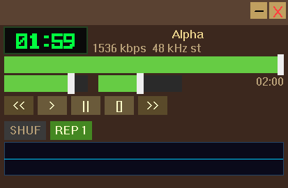
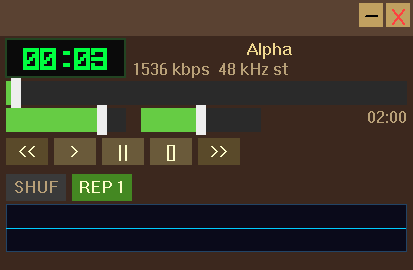

# Ajustes do player — 11/10/2026

## Comportamento

- Repetir alterna **desligado → REP (lista) → REP 1 (faixa) → desligado**.
  `REP 1` repete continuamente a faixa atual quando ela termina. Anterior e
  Próximo continuam navegando; o histórico do aleatório é preservado.
- A playlist inicia encaixada ao player. Mover o player leva a playlist junto.
  Arrastar a barra da própria playlist permite soltá-la. Aproximar suas bordas
  das bordas do player durante esse arraste volta a encaixar, com tolerância
  de 12 pixels lógicos. Selecionar/reordenar faixas não solta a janela.
- Os controles ficam na ordem **Anterior, Play, Pause, Stop, Próximo**,
  compartilhando uma linha e dimensões. O botão Abrir foi removido; adicionar
  arquivos continua disponível em **Adicionar → Arquivos...** na playlist.

O encaixe guarda a borda e o deslocamento lateral, acompanha mudanças de
posição/tamanho do player e preserva a borda ao redimensionar a playlist.
Na abertura, escolhe um lado disponível ou posiciona o par na área útil da
tela, reduzindo a altura inicial da playlist até seu mínimo quando necessário.
Não foi implementada a integração completa com o futuro equalizador.

## Implementação

`src/playback.*` define os três modos e trata repetição de faixa no fim do
áudio. O reinício para/reinicia o som carregado sem recarregar o arquivo nem
reiniciar a navegação aleatória. Isso é necessário porque o motor já encerrou
o som, mas o estado do transporte ainda é PLAYING até o timer tratar o fim.

`src/mainwnd.*` atualiza o botão, desenho/hit-test dos controles e encaminha
mudanças de posição à playlist. `src/plwnd.*` trata o arraste nativo, encaixe,
desencaixe e movimento conjunto. O movimento do mouse é calculado desde a
origem do arraste para que passos pequenos consigam sair da zona magnética.

Não foram adicionadas dependências, nem alterado o callback de áudio.

## Compilação e testes

| Variante | Build | Casos aprovados |
|---|---|---:|
| x64 Debug | OK | 73 |
| x64 Release | OK | 73 |
| x86 Debug | OK | 73 |
| x86 Release | OK | 73 |

Total: **292 execuções aprovadas**, em 12 binários de teste por variante.
Cinco casos adicionais cobrem o ciclo dos modos, repetição de uma faixa com
navegação manual, histórico aleatório, três reinícios usando o motor de áudio
real offline e encaixe/desencaixe/reencaixe nas quatro bordas com mensagens
Win32 no próprio processo. Os demais 68 casos anteriores continuam passando.

Comandos usados para cada arquitetura/configuração:

```powershell
powershell -NoProfile -ExecutionPolicy Bypass -File scripts/dev.ps1 -Action build -Architecture 64 -DebugBuild
powershell -NoProfile -ExecutionPolicy Bypass -File scripts/dev.ps1 -Action test -Architecture 64 -DebugBuild
```

Para Release, omitir `-DebugBuild`; para x86, usar `-Architecture 32`.
Logs: `build/refine-build-*.log` e `build/refine-tests-*.log`.
Sem erros ou warnings novos; permanecem os avisos anteriores de casts DPI
e duas funções GDI não utilizadas. `git diff --check` passou.

## Interface real

Validação detalhada em Windows 11, x64 Debug, escala física 150%, usando
somente a instância lançada pelo helper local. Capturas `PrintWindow/GDI`
foram abertas e inspecionadas pelo agente; mouse/teclado atuaram no desktop
interativo com aprovação pontual da plataforma, sem alterar o sandbox global.

- Estados desligado, REP e REP 1 observados após cliques reais.
- Três WAV silenciosos Alpha/Beta/Gamma adicionados pelo diálogo da playlist.
- Play tocou Alpha; buscar o fim com REP 1 manteve Alpha e reiniciou o relógio.
  Uma captura posterior mostrou o tempo avançando novamente.
- Pause manteve a imagem e o relógio estáveis por mais de três segundos;
  Play retomou. Próximo avançou para Beta mesmo em REP 1. Stop zerou o seek;
  Anterior, após Stop, voltou a Alpha.
- Arraste do player levou a playlist pelo mesmo deslocamento. Arraste direto
  da playlist a soltou; novo arraste do player manteve a playlist parada.
  Reencaixe na borda inferior voltou a permitir movimento conjunto.

As capturas e registros completos estão em `build/gui/events.jsonl`, com
prefixos `refine-` e `adjust-`. Os registros incluem hash do PNG, PID,
instante de criação, caminho e SHA-256 do executável. Houve uma interrupção
de arraste por verificação de janela sob o cursor e uma recusa de observação
desatualizada; essas tentativas não contam como validação. Após nova captura,
os gestos foram repetidos com sucesso e geometria estabilizada.

O manifesto e as imagens selecionadas ficam em [evidence/player-adjustments](evidence/player-adjustments/manifest.json).
Foram arquivadas 25 capturas do executável final e os oito logs de build/teste.
Sete verificações de hashes, geometria e pixels passaram: deslocamento conjunto,
independência, reencaixe, pausa, retomada, seek após repetir e estados do botão.
As sessões intermediárias são identificadas pelo hash que realmente executaram;
não recebem retroativamente o hash do binário final.

Fim de Alpha em REP 1 e reinício da mesma faixa:





No binário final, o primeiro movimento levou ambas as janelas por `(100,30)`
pixels. Solta, a playlist permaneceu em `[1913,1365,2393,1815]` enquanto o
player se moveu por `(100,30)`. Após reencaixar, ambas se moveram por `(60,20)`.
A playlist terminou em `[2009,1375,2489,1825]`, com sua borda superior no mesmo
`y=1375` da borda inferior do player.

## Compatibilidade e limites

As mensagens [WM_MOVING](https://learn.microsoft.com/en-us/windows/win32/winmsg/wm-moving),
[WM_ENTERSIZEMOVE](https://learn.microsoft.com/en-us/windows/win32/winmsg/wm-entersizemove),
[WM_EXITSIZEMOVE](https://learn.microsoft.com/en-us/windows/win32/winmsg/wm-exitsizemove),
[WM_WINDOWPOSCHANGED](https://learn.microsoft.com/en-us/windows/win32/winmsg/wm-windowposchanged)
e [GetCursorPos](https://learn.microsoft.com/en-us/windows/win32/api/winuser/nf-winuser-getcursorpos)
existem desde Windows 2000 segundo a Microsoft, atendendo ao alvo Windows 7.
A execução real em Windows 7 e a movimentação entre monitores de DPI diferente
continuam pendentes. A disposição inicial em telas pequenas foi coberta por
inspeção do código, sem mudar a resolução do desktop do usuário nesta prova.

A M5 mantém seus critérios manuais pendentes. Não foi iniciada a M6 e não
houve commit ou push. As alterações anteriores do ambiente foram preservadas.
