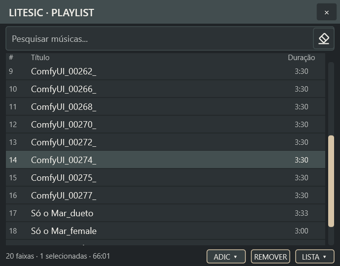
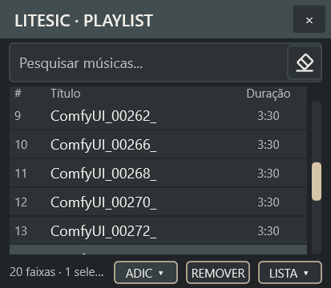

# Duas correções visuais da playlist — 11/10/2026

- Pesquisa: o “×” foi substituído por uma borracha desenhada com linhas da
  própria aplicação, sem depender de uma fonte de ícones. O comando continua
  limpando a pesquisa. Há desenho equivalente no fallback GDI.
- Comandos: **ADIC ▾**, **REMOVER** e **LISTA ▾** ficam à direita da barra
  de status. Usam 52 × 18 DIP, fonte pequena, bordas, cantos e estados de
  hover/pressionado equivalentes aos botões LISTA/EQ do player. ADIC é a
  abreviação compacta de Adicionar; seu menu mantém Arquivos e Pasta.

O resumo de faixas, seleção e duração fica à esquerda, sem sobrepor os
botões. Em largura reduzida, o resumo usa reticências. A antiga faixa
exclusiva de botões foi liberada para a lista. Nenhuma mudança no player,
áudio, persistência, menus ou comandos funcionais.

Validação: quatro builds x86/x64 Debug/Release PASS, sem novos avisos
observados; suíte completa x64 Debug com 89 casos PASS. Após o último ajuste
da borda no fallback GDI, os sete casos de integração da playlist passaram
novamente, incluindo clique no botão de limpar e centralização da faixa no
layout ampliado. Não foram adicionados novos casos; os existentes foram
ajustados para verificar o novo layout e a limpeza da pesquisa.

Na GUI real a 150%, foram inspecionados os tamanhos 690 × 540 e 413 × 360,
além da abertura de Arquivos/Pasta pelo botão na nova posição. O aceite visual
humano permanece pendente. [Logs e hashes das capturas finais](evidence/playlist-footer/manifest.json).

