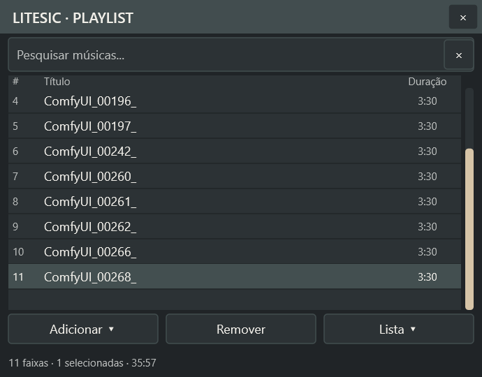
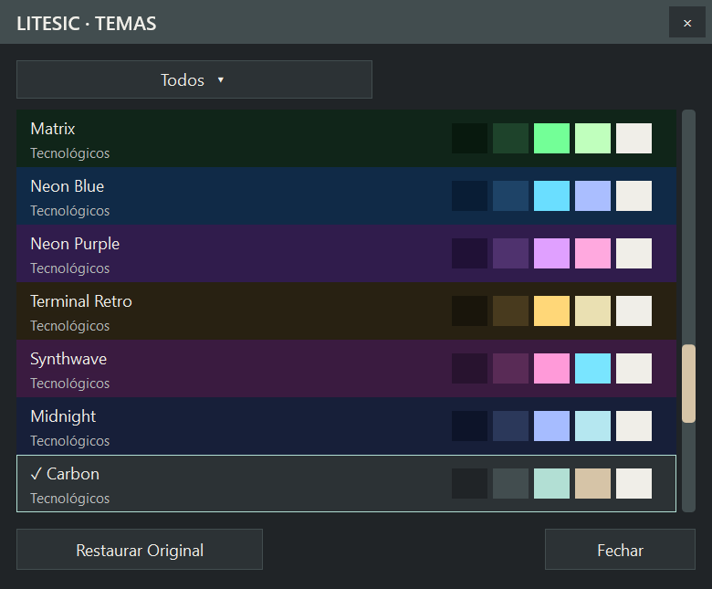

# Playlist, menus e temas — entrega de 11/10/2026

Implementação e validação técnica PASS. Esta entrega reúne os 36 temas da
etapa anterior e os ajustes solicitados depois. O aceite visual humano dos
novos temas e desta reorganização continua pendente; a M5 funcional mantém
seu checkpoint anterior. M6/DSP não foi iniciada.

## Comportamento entregue

- Ao fechar, a playlist salva a faixa selecionada. Ao reabrir, essa faixa
  volta destacada e visível, centralizada quando há espaço de rolagem.
  Play reproduz a seleção restaurada. Não há reprodução automática na abertura.
- **Adicionar ▾**, **Remover** e **Lista ▾** ficam no rodapé. Adicionar reúne
  **Arquivos...** e **Pasta e subpastas...**. Os menus do rodapé abrem para cima.
  Pesquisa, ordenação, M3U, arraste, seleção múltipla e docking permanecem disponíveis.
- O seletor de temas usa barra de título, fechamento, botões, filtro de
  categorias e rolagem desenhados com a paleta da aplicação. Tab, Escape,
  seleção imediata e Restaurar Original continuam funcionando.
- Menus de contexto do player/playlist, menu Lista, Adicionar, categorias e
  submenu de escala compartilham fonte, fundo, texto, destaque e separadores
  do tema ativo. A navegação e o fechamento continuam usando menus Win32.
- O sistema central oferece **36 temas**, códigos estáveis, prévias, aplicação
  simultânea nas janelas, persistência em INI, fallback para Original e
  variações tipográficas. [Arquitetura e catálogo](THEMES.md).

## Persistência e preservação funcional

A lista continua em `%LOCALAPPDATA%/LiteSic/playlist.m3u8`. Seu arquivo
companheiro `playlist.m3u8.ini`, seção `Selection`, guarda índice e caminho
da seleção primária usada por Play. Índice distingue entradas duplicadas;
o caminho é conferido antes da restauração. Uma referência ausente, obsoleta
ou incompatível é ignorada. Seleção múltipla durante o uso continua disponível;
o reinício restaura uma faixa primária, não o conjunto de seleções.

O companheiro é escrito em UTF-16 com BOM para preservar caminhos Unicode.
Só é gravado após salvar a lista com sucesso; falha de gravação informa o
usuário. Sendo um estado opcional, um fechamento interrompido durante essa
gravação pode perder a seleção, sem impedir a abertura da lista M3U.

Não houve mudanças em `audio`, `playback`, modelo/worker/view da playlist,
parsing M3U ou tags. Os ajustes funcionais ficam na janela da playlist;
FFT e osciloscópio recebem somente cores. Não há implementação de equalizador.

Menus alocam fonte, brush e descritores somente enquanto estão abertos,
com liberação após `TrackPopupMenu`. O seletor mantém recursos gráficos da
aparência ativa e oferece desenho GDI de sua barra/rolagem se Direct2D falhar.

## Verificações

**Quatro builds PASS**: x86/x64 Debug/Release. **356 verificações PASS**,
89 em cada variante, em 16 executáveis. **27 testes do auxiliar gráfico PASS**.
[Logs, capturas e hashes](evidence/playlist-ui/manifest.json).

O teste de reinício foi ampliado: ordem/títulos/caminhos preservados, seleção
da segunda entrada, caminho com caractere fora do alfabeto latino, ausência
de autoplay, Play na faixa restaurada, rejeição de caminho obsoleto e lista
limpa sem ressuscitar entradas. Testes de coordenadas foram ajustados ao novo
layout. As verificações de temas continuam cobrindo contraste, texto em
espaços fixos, pesquisa/seleção/estado de áudio/geometria durante trocas,
categorias, restauração, descarte de target e carga de memória.

Na GUI real, foi selecionada a última faixa, fechado e reaberto o aplicativo:
o destaque voltou; Play reproduziu a mesma faixa. Depois a reprodução foi
parada. Filtro Clássicos exibiu duas opções, Claro foi aplicado e Restaurar
Original funcionou; ao terminar, o tema voltou ao Carbon que estava ativo
antes da validação. A playlist pessoal manteve SHA-256 idêntico ao backup
local: `86b68df1802d1f87568ed1c9f8070c9a3fa4caafb2c73e41f75e4d52f3f55a5d`.
Não foi publicado arquivo de playlist pessoal nem backup de configuração.





Outras evidências: [Adicionar](evidence/playlist-ui/adjust-final-add-menu.png),
[Lista](evidence/playlist-ui/adjust-final-list-menu.png),
[menu do player](evidence/playlist-ui/adjust-verified-main-menu.png),
[categorias](evidence/playlist-ui/adjust-verified-categories.png),
[filtro Clássicos](evidence/playlist-ui/adjust-verified-classic-filter.png),
[Claro](evidence/playlist-ui/adjust-verified-light-selector.png),
[Original restaurado](evidence/playlist-ui/adjust-verified-restore-original.png),
[seleção após reinício](evidence/playlist-ui/adjust-final-restored-selection.png)
e [Play da faixa restaurada](evidence/playlist-ui/adjust-final-play-restored.png).

São 14 capturas: nove do binário final e cinco complementares anteriores
somente aos ajustes de Unicode no companheiro e fallback GDI do seletor.
O manifesto identifica os executáveis separadamente. A
[galeria anterior dos oito temas](evidence/themes/index.html) registra a
primeira etapa, antes de mover os comandos e personalizar o seletor.

## Memória

Nova rodada: **1.980 trocas por variante**, 7.920 no total, com pintura real
do player e playlist e 11 amostras por processo. [Amostras completas](evidence/playlist-ui/memory.json).

| Variante | Private bytes após 180 / 1.980 trocas (MiB) | GDI/USER início → fim | Handles início → fim |
|---|---:|---|---|
| x86 Debug | 65,68 / 63,43 | 52/51 → 52/51 | 695 → 695 |
| x86 Release | 66,04 / 63,78 | 52/51 → 52/51 | 693 → 693 |
| x64 Debug | 90,52 / 81,00 | 52/51 → 52/51 | 822 → 822 |
| x64 Release | 91,17 / 81,66 | 52/51 → 52/51 | 822 → 822 |

Não houve crescimento contínuo observado nessa carga. O teste aceita até
8 MiB acima da primeira amostra aquecida e até dois objetos GDI/USER; os
valores finais ficaram abaixo do início e os contadores permaneceram estáveis.
Isso não prova ausência de vazamentos em sessões longas nem permite atribuir
todo o consumo ao tema. Não houve refatoração do motor ou do backend gráfico.

## Limites e reprodução

Caixas de arquivo/pasta e mensagens de erro do Windows continuam nativas.
A borda e a seta de submenu dos popups também são gerenciadas pelo Windows.
O tratamento visual solicitado nas imagens cobre as janelas e menus próprios
do LiteSic. Win7 em VM, transição física entre monitores com DPIs diferentes,
falha forçada de Direct2D no seletor e sessões prolongadas continuam pendentes.
Avisos antigos de cast DPI/helpers GDI permanecem; não foram observados novos
avisos nas unidades adicionadas.

```powershell
# Repetir para 32 bits e sem DebugBuild para Release.
powershell -NoProfile -ExecutionPolicy Bypass -File scripts/dev.ps1 -Action build -Architecture 64 -DebugBuild
powershell -NoProfile -ExecutionPolicy Bypass -File scripts/dev.ps1 -Action test -Architecture 64 -DebugBuild
powershell -NoProfile -ExecutionPolicy Bypass -File scripts/gui.ps1 -Action test
# Auditar os artefatos gravados desta rodada, depois das capturas:
.tools/gui-venv/Scripts/python.exe scripts/diagnostics/package_adjustments.py
```

APIs verificadas na documentação oficial: [SetWindowSubclass](https://learn.microsoft.com/en-us/windows/win32/api/commctrl/nf-commctrl-setwindowsubclass)
(XP), [SetMenuInfo](https://learn.microsoft.com/en-us/windows/win32/api/winuser/nf-winuser-setmenuinfo)
e [WritePrivateProfileSectionW](https://learn.microsoft.com/en-us/windows/win32/api/winbase/nf-winbase-writeprivateprofilesectionw)
(Windows 2000), anteriores ao alvo Windows 7. Isso verifica disponibilidade de
API, sem substituir execução em VM.

Uma tentativa de substituir temporariamente a playlist pessoal por uma fixture
foi rejeitada pela revisão automática de aprovação, por risco de sobrescrita,
e abandonada. A validação prosseguiu com sessão isolada nos testes e com a
lista existente na GUI. Uma entrada com observação de alvo desatualizada foi
recusada pelo auxiliar; a captura foi atualizada e a ação repetida com sucesso.

A publicação desta entrega foi autorizada expressamente no pedido atual,
incluindo as alterações de temas que ainda não tinham commit. O resultado
efetivo do commit/push é informado na mensagem de entrega.
