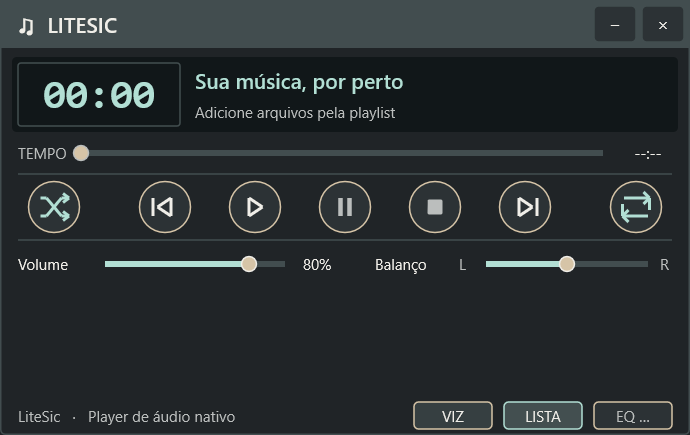
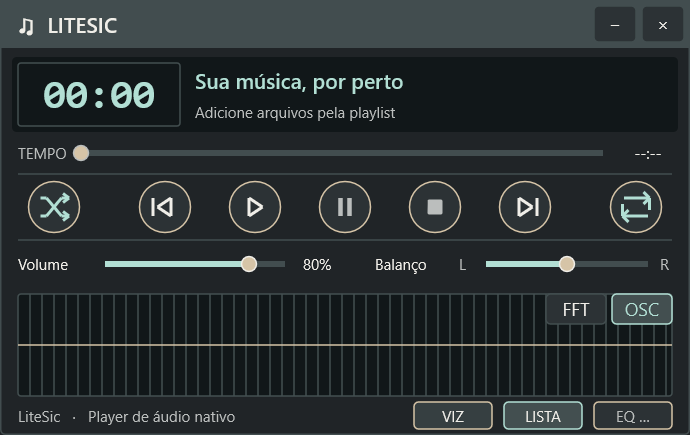

# Mostrar e ocultar o visualizador — 11/10/2026

O botão **VIZ**, à esquerda de LISTA e EQ no rodapé do player, alterna a
visibilidade do osciloscópio/espectro FFT. Usa o tema ativo, tooltip e
navegação por teclado. O modo FFT/OSC escolhido é preservado ao restaurar.

Ocultar mantém as dimensões da janela e deixa livre a área do visualizador.
O desenho periódico fica suspenso enquanto oculto; a reprodução e os
controles de áudio continuam disponíveis. A visibilidade começa ativada
ao abrir o aplicativo; esta opção não é persistida entre sessões.
O caminho GDI também oferece o botão e respeita a visibilidade.

## Verificação

- Compilação x86/x64 Debug/Release: PASS, sem novos avisos.
- Suíte x64 Debug: 89 testes aprovados. O teste da janela real verifica
  pixels ao ocultar/restaurar e confirma que o áudio permanece pausado.
  Os demais testes de transporte e seek continuam aprovados.
- Validação gráfica no Windows 11, x64 Debug, escala 150%: PASS.
  Cliques reais em VIZ ocultaram e restauraram a área e os botões FFT/OSC;
  a geometria permaneceu 690 × 435 pixels.

Capturas da janela real, produzidas pelo auxiliar restrito `scripts/gui.ps1`:

| Antes | Oculto | Restaurado |
|---|---|---|
|  |  |  |

Logs e registros de captura ficam em `evidence/visualizer-toggle/`.
A validação gráfica foi feita no caminho Direct2D; o fallback GDI foi
compilado, mas não foi forçado nesta rodada. Não foi realizada validação
em Windows 7 nesta tarefa.
